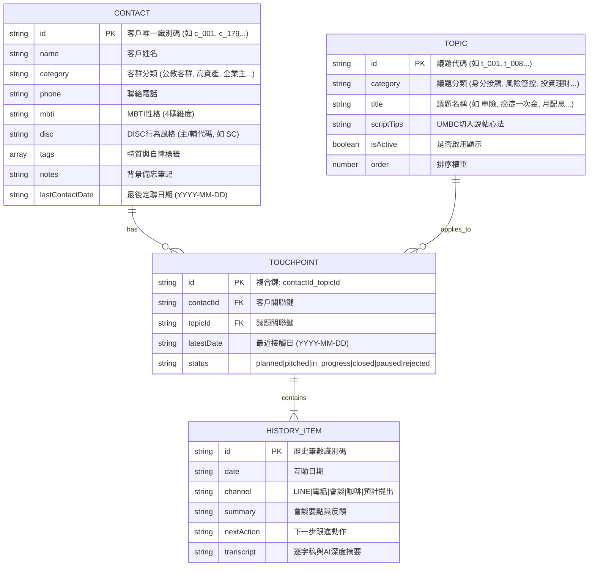

# 需求規格書：定聯 x 議題 x 案件｜紀錄管理系統 (Regular Contact & Topic Tracking System)

> **版本**：v2.1 (全地圖 6 欄戰略看板與人體工學大按鈕版)  
> **最後更新日期**：2026-10-03  
> **維護原則**：本文件為本專案之真實核心規格書，隨使用者需求變更即時持續更新。

---

## 1. 系統目標與業務場景

傳統 CRM 系統往往以「時間線性流水帳」呈現，當顧問面對數十至數百位高資產或各類客群時，極難一眼掌握：
1. **議題推進盲點**：哪位客戶在「哪項特定議題（如：身心停藥防癌、分紅保單、養生村、意定監護、組織增員）」已經切入聊過？
2. **質性反饋掌握**：當時客戶的反饋為何？推進到何種階段？
3. **客戶溫層警示**：哪些客戶已經超過 30 天未進行任何關懷與議題互動？
4. **展業動能閉環**：當前議題交流告一段落或遭到婉拒時，下一個切入焦點是什麼？

本系統透過**「Y軸客戶名單 × X軸議題庫」的二維交匯矩陣畫布**，搭配**「三秒極速定聯微紀錄抽屜」**、**「全地圖議題戰略選取」**與**「客戶大畫面檔案維護」**，徹底消除記錄與檢索的心智負擔。

---

## 2. 核心功能規格詳細清單 (Feature Specification)

| 模組編號 | 功能模組 | 詳細規格與驗收標準 |
| :--- | :--- | :--- |
| **F-01** | **雙向凍結二維矩陣畫布** | • 垂直滾動時頂部議題列（Thead）維持 Sticky 凍結固定。 • 水平滾動時左側客戶名單欄（Tbody Th）維持 Sticky 凍結固定。 • 左上角交匯儲存格（Corner Cell）永遠置頂，維持乾淨的「+ 議題」功能按鈕。 |
| **F-02** | **極簡首頁與幾何行高秩序** | • **首頁第一欄簡化**：僅保留「溫層燈號」、「客戶姓名」與「性格特質（MBTI / DISC）」，杜絕破框與多餘換行。 • **列高絕對齊平**：所有客戶列高鎖定在 63~64px 基準高度，絕不因資料多寡而參差不齊。 • **未填寫色塊方框**：若客戶尚未填寫性格特質，保留與已填寫者「相同底色（MBTI 藍灰底 / DISC 陶橘底）、相同尺寸（寬度由幽靈文字自然撐開）」之留空白方框，維持極致的卡槽結構美感。 |
| **F-03** | **性格特質與心理學維度** | • **DISC 簡約化**：移除冗贅中文解釋，僅保留「DISC 主」、「DISC 輔」獨立選擇器，顯示為代碼標籤（如：`SC型`）。 • **MBTI 4×2 按鈕矩陣**：編輯彈窗內建 `E/I`、`S/N`、`T/F`、`J/P` 快速切換矩陣，解決傳統下拉選單難找、尋找時間過長之痛點。 |
| **F-04** | **零誤觸符號化與防呆門禁** | • **符號化操作**：刪除鍵改為簡潔小巧的 `✕`，取消鍵改為 `－`（兼具關閉功能），儲存鍵改為 `◯`。 • **刪除二次防呆**：點擊 `✕` 時強制彈出二次防呆確認，避免誤刪珍貴客戶或紀錄。 • **遮罩關閉支援**：點擊 Modal 或 Drawer 外部遮罩空白區域等同關閉。 • **Dirty State 髒資料防呆**：若編輯畫面已有修改但尚未點擊儲存，點擊關閉或遮罩時強制跳出「變更尚未儲存」警告。 |
| **F-05** | **操作動線精準分流** | • **點擊姓名**：開啟足夠寬闊的大畫面客戶維護彈窗（編輯基本資料、電話、標籤、備忘、性格）。 • **點擊其餘空間**：啟動客戶專屬的「議題聚攏篩選」（三段循環：有記錄 ➔ 未開議題 ➔ 恢復全部）。 |
| **F-06** | **三秒定聯微紀錄抽屜** | • 點擊交匯儲存格無縫滑出右側抽屜，整合該議題之 UMBC 切入說帖小抄（支援一鍵複製）。 • 填寫會談日期、接觸管道、推進狀態、一句話摘要、下一步跟進動作與語音逐字稿。 • 內建常用跟進快速標籤（下週電話、備試算表、約咖啡面聊、下月再關懷）。 |
| **F-07** | **全地圖 6 欄看板與純粹清單按鈕** | • **抽屜單一戰略大按鈕**：取代狹窄點選盒，以專屬大按鈕喚起 95vw 大畫面全景清單，選定後自動顯示「🎯 已選定推進：【議題名】」並支援一鍵清除 `✕`。 • **第一行 6 大分類看板清單**：第一行為「身份接觸、風險管控、投資理財、稅務傳承、生活議題、組織增員」，向下垂直陳列各子議題按鈕。 • **極致減法純粹按鈕**：移除「可推進、推進、未切入、已鎖定」等文字，按鈕僅顯示「議題名稱」，狀態全以按鈕色彩區分。 • **進度色彩淡化鎖定**：已推進或記錄中議題依狀態色彩淡化 (opacity 0.38) 虛線鎖定禁用（disabled）；未切入議題高對比浮凸，點擊立即選定推進並關閉大畫面。 |
| **F-08** | **婉拒戰略全地圖轉向** | • 當某議題推進狀態被標記為「婉拒/拒絕」時，系統自動彈出「議題戰略全地圖」Modal，引導顧問從全局出發，挑選下一波切入焦點，維持展業動能不斷線。 |
| **F-09** | **雙向雲端同步與數據持久化** | • 本機 `localStorage` 即時儲存，重新整理（F5/Cmd+R）不遺失任何新增客戶（如：何坤彥）與交匯紀錄。 • 雲端 Google Sheets 串接：拉取時採取雙向安全合併（Merge），保留本機新增之名單與交匯進度，不發生舊試算表覆蓋沖刷。 |

---

## 3. UI/UX 核心設計哲學與人體工學 (Ergonomics)

1. **視覺認知減法 (Cognitive Subtraction)**：
   * 移除進度條與視覺雜訊，首頁僅呈現燈號、姓名、性格心錨，保護顧問在面對高資產客戶時的專注力。
2. **幾何水平齊平 (Geometric Consistency)**：
   * 採用幽靈色塊技術，讓無資料的卡槽維持與填寫者完全一致的底色與尺寸，確保網格線條穩定、無跳動感。
3. **高信噪比符號語言 (Minimalist Iconography)**：
   * 以 `✕`（刪除）、`－`（取消/關閉）、`◯`（儲存確認）取代厚重文字按鈕，提升平板展業時的俐落度。
4. **雙軌動線分離 (Dual-Track Interaction)**：
   * 姓名聚焦於客戶資料維護，卡片周邊空間聚焦於畫布篩選聚攏，零學習成本且防誤觸。

---

## 4. 資料模型架構 (Data Architecture)

